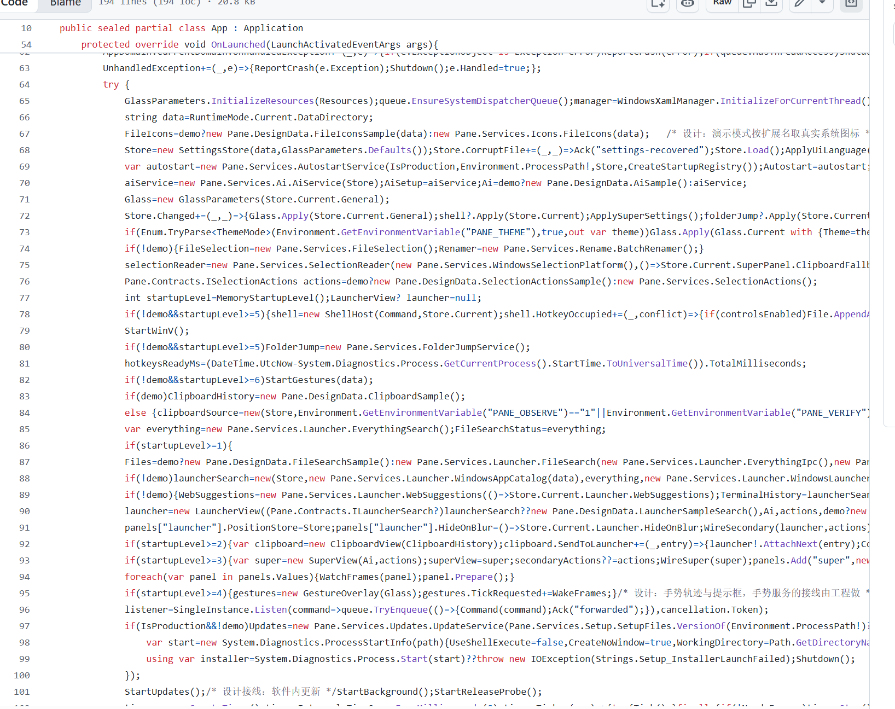
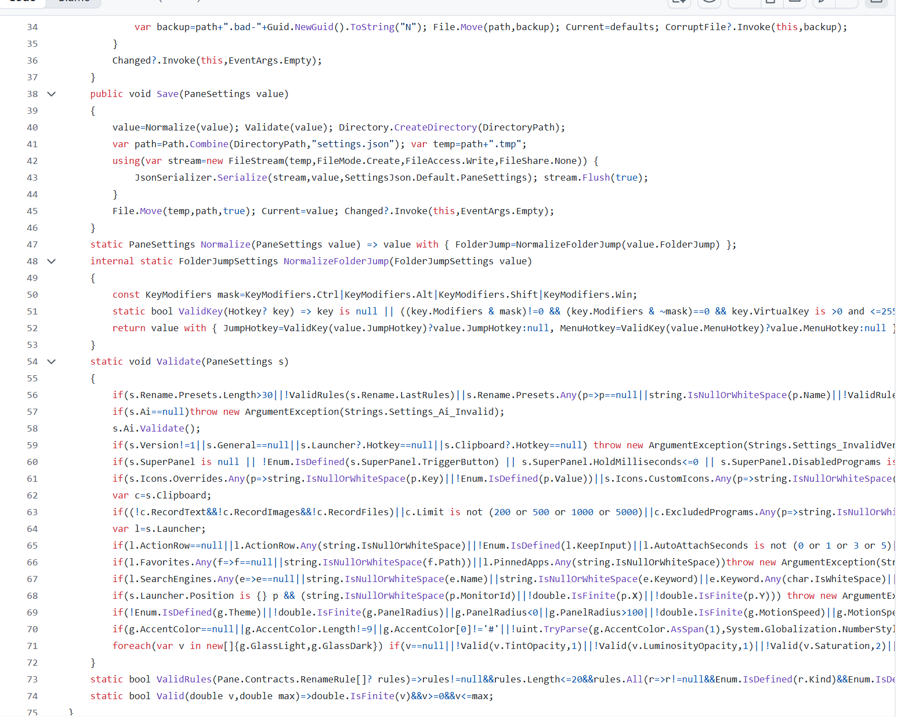
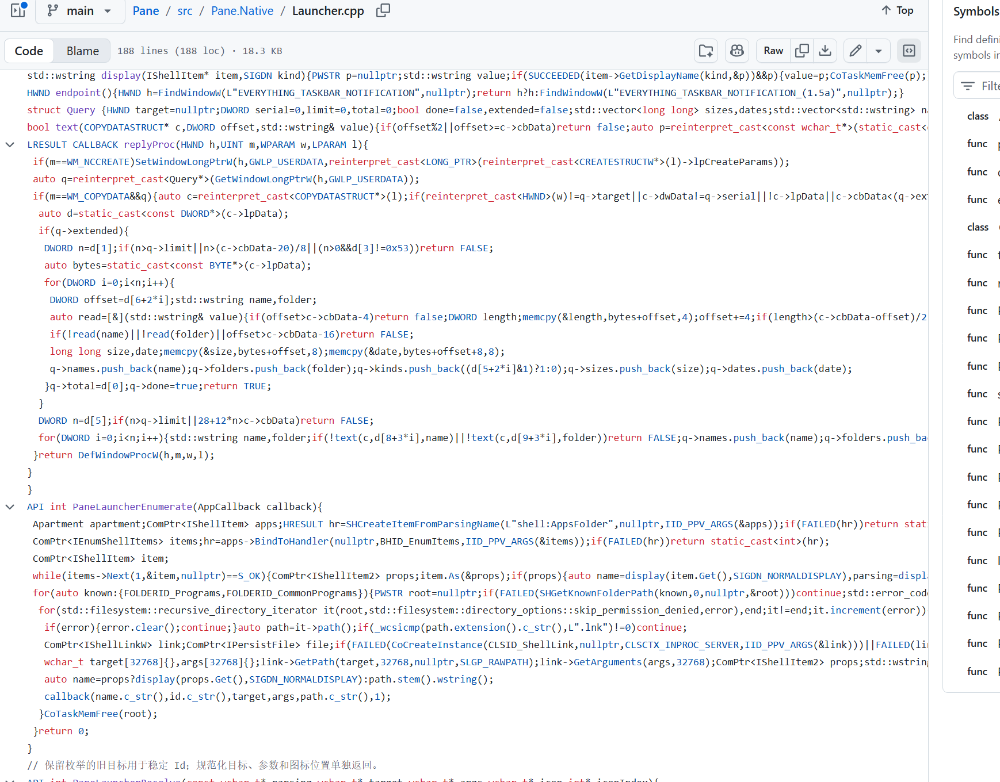
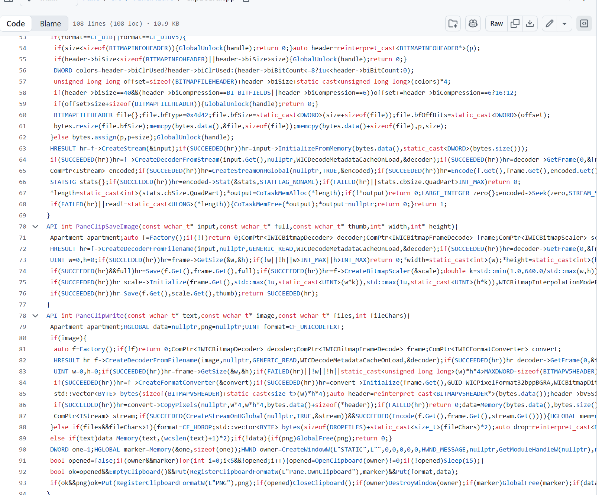
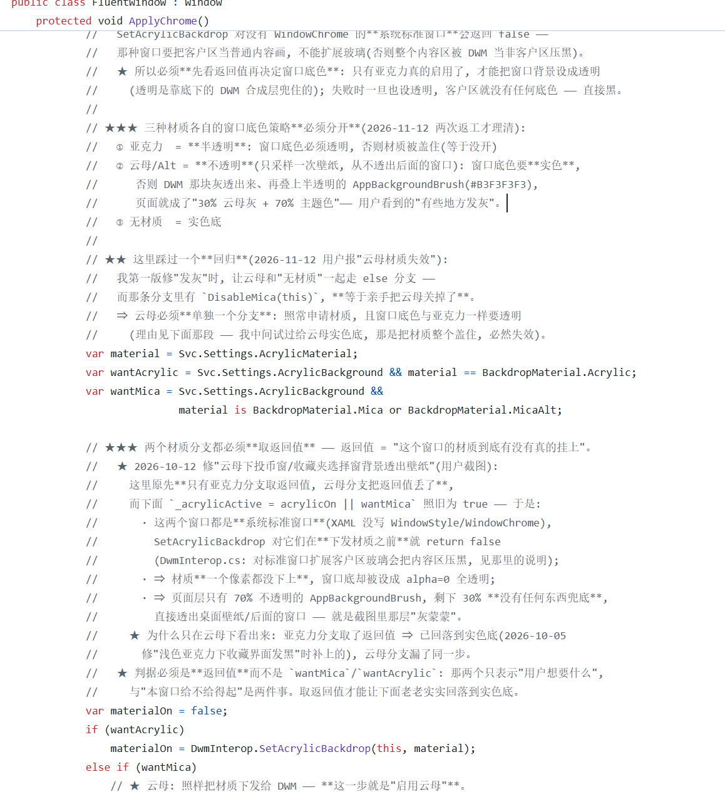
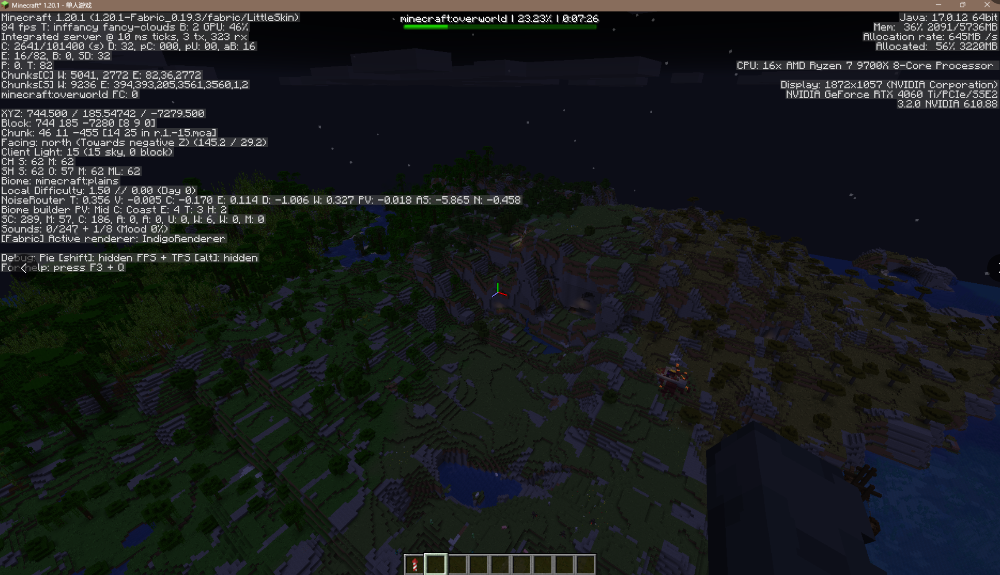
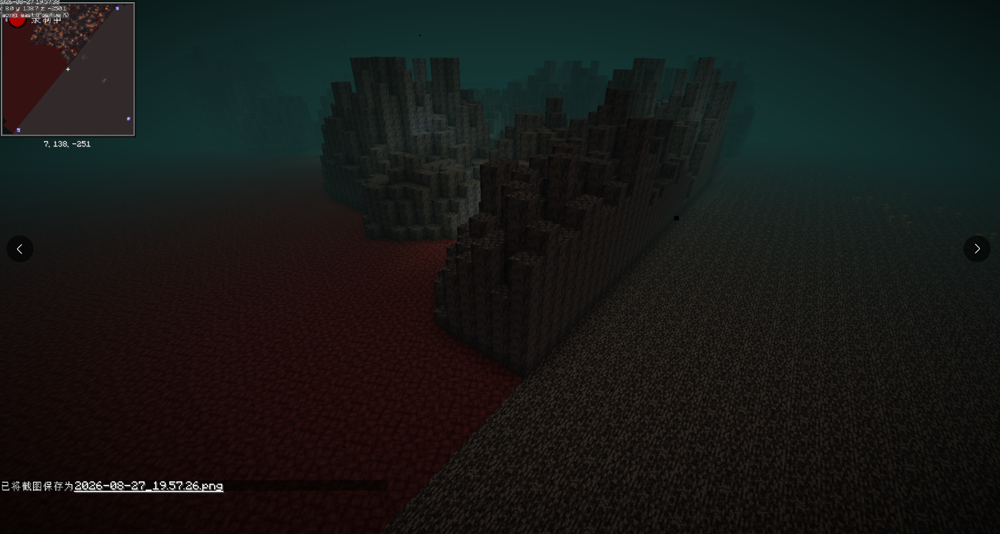

[#]>AI|
[state]| NOAI
[text] | 必须重拳出击

## 前言

随着 AI 的兴起vibe coding开始进入大众的视野，越来越多的人接触并开始使用。但笔者今天想表明的观点正是当今vibe coding并不是一个可以无脑让AI去生成应用的东西，它目前存在诸多缺陷和问题且有些问题并不是随着AI能力的提升就能解决的。

> [!NOTE]
> 个人观点，请勿过渡解读

## AI幻觉，人也有?

|一段很乱的C#代码|还是很乱的C#代码|依旧很乱的C++代码|这是啥？？？|过多的无意义注释|
|---|---|---|---|---|
|||||(注释里日期都出现了AI幻觉)|

图中代码出自以下仓库和视频

<https://www.bilibili.com/video/BV1PVxv6rEsL/>

<https://www.bilibili.com/video/BV18V4w6xEhW/>

<https://github.com/LBEILC/Pane>

<https://github.com/ABING1111/BiliDesk>

如果你没学过编程，你可能对上面三张图中的代码没什么概念，但要我说`这种代码和屎的区别是屎还可以被自然降解，而这些代码只会屎壳郎滚粪球越滚越大`。

**这些代码是100%无法通过代码质量审查的，其中也埋藏着大量的不规范问题和各种问题的代码段。**

如果说只是代码风格问题那你就低估这个问题的严重性了。当我看到这些代码时，我的第一反应是文件乱码了？仔细看才发现是一段代码，这本质上是一个完全不懂软件开发和编程语言的人，拿着AI就想做出产品，但最终做出了个经不起推敲的屎山，表明光鲜艳丽，背后却一塌糊涂。?? (或许只有外星人、未来人、超能力者才能看懂在做什么) ??

vibe coding并不是完全不具备专业知识就能上手的东西，特别是在上图中的C++代码段中就能发现其中诸多的内存安全问题。再往深了讲，**AI根本不懂使用编程技巧、设计模式、遵守代码规范等内容**，`觉得靠AI靠vibe coding就能写出好软件本质上就是这些人初次接触vibe coding被其所带来的便利性和对自身在该方面被超越而产生的幻觉，而并非AI真的能做的很好`。

当然，并不是说AI不能做，只不过是AI与人相比还是有不少差距。我也用过vibe coding且我自身也有丰富的开发经验，即使是在投入大量提示词和代码要求的情况下，经过层层的人工对设计文档审阅，AI生成的代码也只能达到我能接受的水平，而并非是我觉得满意的水平，要达到让我觉得好的水平还差的很远，AI生成的代码质量还是不如我亲自手写质量来的好。

至于连vibe coding都没用明白的人，也包括这些人也几乎没有开发经验和软件相关领域知识，也没有掌握任何的编程语言及开发工具 _(我不认为会写几行代码就掌握了一门编程语言，人人都会 Hello World 岂不是人人都会任何一门编程语言。语言是工具，软件开发看重的是抽象与系统设计、测试与质量保障、工程实现等能力)_ ，拿着系统提示词都做的很差的Agent产品去写代码，写出来的代码甚至是人类难以阅读的。至于规范就更不用说了，一段人类难以阅读的代码能有什么规范？不说别的，你起码也要用个好提示词配好Agent产品，你得知道不同模型在不同Agent产品中能力是不一样的。而不是认为我拿这个去写代码就可以了，还是要**好马配好鞍**。

> “A fool with a tool is still a fool.”（拿着工具的傻瓜，依然是傻瓜。）
> --- Grady Booch（IBM院士，UML创始人之一）

**打铁还需自身硬**， 这句话的道理放在这篇文章里我觉得非常好。任你有多么强大的AI，最终的评判标准还是人类，不符合标准那就是做的差。而人类作为评判标准自然应当知道怎么做才符合规范和要求，进而指挥AI向规范的方向编写代码。AI本质上是一个解放一部分劳力工作的工具，让人们能抽出精力用于抽象与系统设计，而不是作为一个专业人员的替代品，AI需要一个自身具备能力的人去指挥工作。

**君子使物，不为物使**，代码写的不好只是个小问题，通过学习和努力亦可提升自己的能力，从而编写出更好的代码。坏就坏在有些人并不想学习，让这些人学习，仿佛要了他们的命。一说他们他们就“满嘴跑火车”，还与你持敌对态度。一些人抱着浮躁心态，想当然地认为 _“都有AI了我为什么还要学这些”_，真是可悲！

## 光鲜艳丽亦是糟粕不堪

|过于追求透明质感的UI|很丑陋的UI|缺乏设计的UI|这是草履虫的艺术作品？|
|---|---|---|---|
|||||

图中代码出自以下仓库和视频

<https://www.bilibili.com/video/BV1PVxv6rEsL/>

<https://www.bilibili.com/video/BV1mFam68ER8/>

<https://github.com/LBEILC/Pane>

<https://github.com/shaun-chen2/GlassMC>

<https://github.com/duyuanfu/evan-ocr>

整体来说 UI/UX 这块相较于上面的代码问题还是小上很多的。大部分可能处于自身感官上的感受或借鉴其他设计，设计出来的UI并不算太差，只是略显平庸，缺乏一些打磨工作，对细节上的完善和对设计能力的欠缺问题弥补弥补就行了，除了极个别界面有问题整体审美上倒是没有什么大问题。

大部分产品的总体观感上还说的过去。但是呢，其中也不乏一下初高中生或小孩子的作品，这部分就比较难评了，大部分做的都有点小差。考虑到学生忙于学业对审美缺乏相关教育和培养，这也说的过去。主要问题还是出在多大的人了还留着小孩般的审美，或者说是一些老登从小就对审美这个概念理解有问题，他们理解的“美”或许和我们理解的并不一样。很土的那种。

对于借鉴设计还是值得聊聊的，很多人借鉴苹果的设计其实抄答案都抄错了。拿苹果MacOS26举例，很多人借鉴他的透明亚克力背景，但苹果的透明亚克力背景是用在弹出窗口上，对于应用的主界面依然保持的是白底黑字设计。很多人一看，这设计很高级很果味，于是就把他搬到自己应用的主界面上，偏偏抄答案还抄错了，界面背景不透明度比苹果低还只是小问题，关键是把弹出对话框的样式套到应用主界面上，还是没有学到设计上的精髓。

除此之外还有个技术选型的问题，太多人做界面就套个前端、WPF、QT以及自绘UI。你说你有相关的经验还好，偏偏很多人没有，WPF这种早就被抛弃的东西都端上来 _（WPF的年龄可能比这群小孩子都大，注：2006年Longhorn中的Avalon才被微软正式命名为WPF）_，这玩意一般人用的话渲染性能都不一定有 Flutter 渲染性能高。至于前端做应用UI我是觉得也挺好的，起码有个界面用。QT和自绘UI还是需要一定自身能力才能驾驭的，特别是不使用Skia或TGFX而是直接使用图形API的自绘UI，大部分人的设计我看下来并不满意，并不是说比较差，而是可以做的更好，只是要投入的时间和精力非常多，没个几年还是不够完善的。

## 类人群星闪耀时

> [!WARNING]
> 如果你有心血管疾病病史，请谨慎阅读以下内容，不要点进视频链接中的评论区查看

以上内容我们只是在谈论vibe coding说带来的一些问题，那么下面这些内容可谓是类人群星闪耀时

显然，嘉豪人群并不懂得什么是低调~~（就很装你懂的）~~，没有自知之明，认为有vibe coding自己就是可以和专业人员掰手腕。

<https://www.bilibili.com/video/BV1vQM16yE2T>

|评论区-1|评论区-2|评论区-3|评论区-4|真“噪声”|真“噪声”|
|---|---|---|---|---|---|
|||||||

可以很明显的看出这人根本就是啥也不懂，拿个AI生成内容就来回复评论区了，什么叫你R3层直接写CPU的L2缓存？啊？L2缓存都不是一个可直接寻址的存储空间，它是由CPU硬件自动、透明地管理的。这完全是在胡言乱语也就骗骗不懂行的人了。至于性能优化，噪声是真噪声那能不快吗？区块生成出的地形有着明显的问题，地形都不是连贯的。而本视频的作者也是很没有自知之明，所谓的提升也只是用AI用出的幻觉罢了。除了脸皮厚外，嘴上功夫当然也不能落下，正所谓我不尴尬，尴尬的就是别人，一本正经的胡说八道，既要更新mod又要和评论区网友对线，世上还有这么“勤劳”的人。

<https://www.bilibili.com/video/BV1ku376JE2h>

|换源前封面与标题|换源后封面与标题|精选评论|事后道歉|精选评论|
|---|---|---|---|---|
||||||

虽说这位作者有点狂妄自大，但至少还是有自知之明的，也知道事后道歉。正所谓大人不记小人过，这里就不多说什么了。年少轻狂也是吃了一边社会毒打了，希望以后能涨涨记性。另外作者提到的“纯手搓”但只要看过项目仓库就能发现项目里明摆着`AGENTS.md`文件还坚称纯手搓，阅读源码也不难发现其中一些AIGC内容与低俗注释，说实在的，承认使用AI生成并不是什么耻辱的事，耻辱的是用着AI还坚称“手搓”并且狂妄自大的家伙。

另外网上也有不少一边用着前端一边宣称自己应用多么的快，使用AI用XXX重写XXX，占用多么的小（其实根本不快也不小更不好用）不过呢这些都是vibe coding项目且 `有、快、小≠好`，产品最重要的还是对功能的打磨，对用户提供技术支持和完善的社区，有些人可能魔怔了，在他们映像中小就是好，特别是这些所谓的“自由软件主义”，你反对他们一旦扯上商业软件他们就要给你扣上“资本主义”的帽子，这群人根本不是拿工具做生产力工作的，纯纯的来站边搞对立的一群“二极管”。
